<div align="center">


# FateGlass

**A fast photo viewer for Windows and macOS, every feature switched on and nothing phoning home.**
<br/>
Every image you open, held in the light a moment longer.

<br/>

[](../../releases/latest)
[](../../releases)
[](../../actions/workflows/release-installer.yml)

[](#install)
[](#on-a-mac)
[](#build-from-source)
[](#how-it-is-built)
[](#themes)
[](LICENSE)
[](#credits-and-license)

<br/>

[Install](#install) &nbsp;·&nbsp;
[What is different](#what-is-different-from-imageglass) &nbsp;·&nbsp;
[Themes](#themes) &nbsp;·&nbsp;
[Lock zoom](#lock-zoom) &nbsp;·&nbsp;
[Settings](#settings-and-defaults) &nbsp;·&nbsp;
[Build](#build-from-source) &nbsp;·&nbsp;
[Release](#make-a-release)

</div>

<br/>

FateGlass is a personal build of [ImageGlass 10](#credits-and-license), the open source image viewer, rebranded for
VagueDustin Enterprises. It opens 90+ formats (WEBP, JXL, AVIF, HEIC, SVG, HDR, PSD and camera raw among them),
browses folders quickly, and stays out of the way of the picture. This build turns on every feature the upstream
project reserves for paid licenses, removes the update check and its usage statistics, and ships with a navy and
gold look, 12 more themes and its owner's settings as the defaults.

FateGlass is shared as is, under the same GPLv3 license as ImageGlass.

---

## Install

1. Open the [latest release](../../releases/latest) and download `FateGlass_<version>_win-x64.msi`.
2. Run it and approve the Windows prompt. It installs for all users to:

   ```
   C:\Program Files\VagueDustin Enterprises\FateGlass
   ```

3. Start **FateGlass** from the Start menu.

Installing a newer release upgrades in place. To remove it, use **Settings > Apps > Installed apps > FateGlass >
Uninstall**; that also clears any file type associations FateGlass registered.

FateGlass runs side by side with an installed ImageGlass. It has its own name, settings folder, file type
registrations and single-instance lock, so neither app touches the other.

> **Windows SmartScreen.** The installer is not code signed, so Windows may show "Windows protected your PC" the
> first time. Choose **More info > Run anyway**.

### On a Mac

FateGlass for Mac runs on Apple silicon (M1 and later).

1. Open the [latest release](../../releases/latest) and download `FateGlass_<version>_osx-arm64.dmg`.
2. Open it and drag **FateGlass** onto **Applications**.
3. Start FateGlass from Applications. The first time, macOS blocks it, because the app is not signed by an Apple
   developer account: choose **Done**, then open **System Settings > Privacy & Security**, scroll down to the message
   about FateGlass and choose **Open Anyway**. Later starts open normally.

   The same thing in Terminal, if you prefer:

   ```bash
   xattr -dr com.apple.quarantine /Applications/FateGlass.app
   ```

FateGlass sits alongside any ImageGlass for Mac, with its own app ID (`com.vaguedustin.fateglass`) and its settings in
`~/Library/Application Support/FateGlass`. The Mac version keeps the toolbar and gallery in full screen by default.
To install a newer release, drag it onto Applications again and replace the old copy.

To build it yourself instead (see [Build for macOS](#build-for-macos)):

```bash
bash source/__assets/mac/fateglass/build-fateglass.sh --install
```

To make it the default viewer, open **Settings > File type associations** and choose **Register**. macOS asks you to
confirm each file type that another app opens today, so you can keep that app for any of them; formats no other app
declares (JFIF, APNG, JXR, CUR and the like) switch without asking. **Unregister** gives each type back to the app it
had before. To take over only some formats, pass them on the command line instead:

```bash
/Applications/FateGlass.app/Contents/MacOS/FateGlass --ig-set-default-viewer ".jpg;.png;.heic"
```

---

## What is different from ImageGlass

| Area | ImageGlass 10 (Classic) | FateGlass |
| --- | --- | --- |
| File watcher (live folder changes) | Pro | Included, on by default |
| Free panning and margin panning | Pro | Included, on by default (100 px margin) |
| Settings page for mouse click actions | Pro | Included |
| Auto-open newly added images | Pro | Included |
| Default and admin config files (`igconfig.default.json`, `igconfig.admin.json`) | Pro | Included |
| Projector view sync and pointer, HDR Tone Mapper | Pro | Included |
| File type associations and file type icons | Included | Included, with FateGlass icons |
| Update check | Daily background check | Removed |
| Usage statistics | Sent with the update check | Removed with it |
| Upgrade prompts, license screens, Pro badges | Shown | Removed |
| Links to the upstream website and repos | Throughout the app | Hidden, and blocked as a safety net |
| Lock zoom | A zoom mode | A toggle: press again to release it |
| Look | Kobe themes, blue icon | FateGlass navy and gold, 13 themes, new icons |
| Defaults | Factory | The owner's settings, synced on every build |

FateGlass makes no network requests of its own. The only remaining web links are ones you configure yourself, such
as a plugin's homepage.

---

## Themes

Every theme shares one icon set, recoloured to its palette. The palettes come from
[Fate Takes You Home](https://github.com/VagueDustin/fate-takes-you-home), so FateGlass matches the rest of the
house. Pick one in **Settings > Appearance**.

<table>
<tr>
<td align="center" width="33%">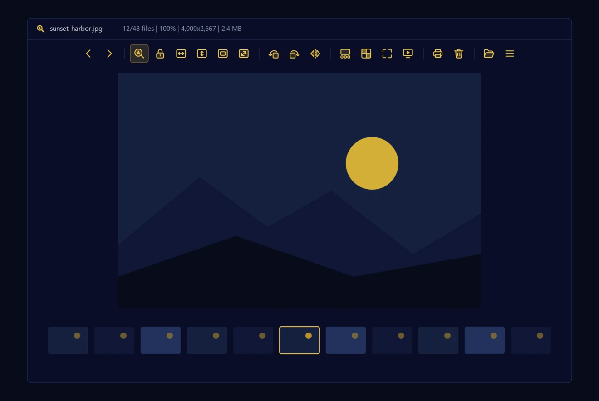<br/><b>FateGlass</b><br/><sub>Navy and gold, the house look</sub></td>
<td align="center" width="33%">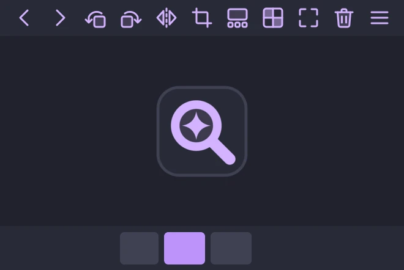<br/><b>Dracula</b><br/><sub>Soft violet on deep grey</sub></td>
<td align="center" width="33%"><br/><b>Nord</b><br/><sub>Arctic blues</sub></td>
</tr>
<tr>
<td align="center">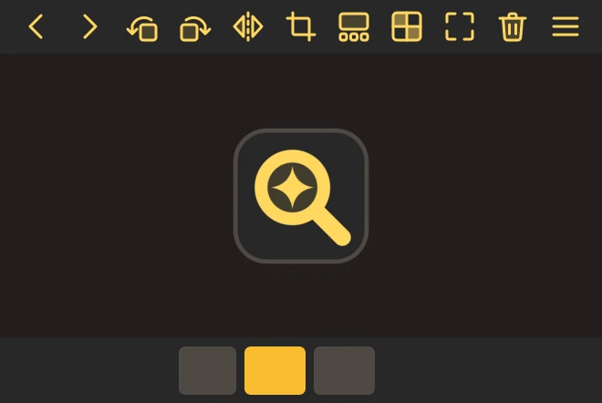<br/><b>Gruvbox</b><br/><sub>Retro amber warmth</sub></td>
<td align="center">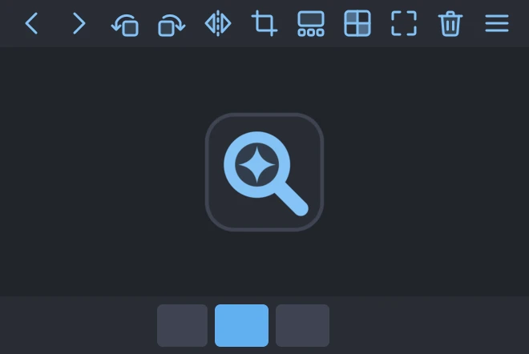<br/><b>One Dark</b><br/><sub>The classic editor dark</sub></td>
<td align="center">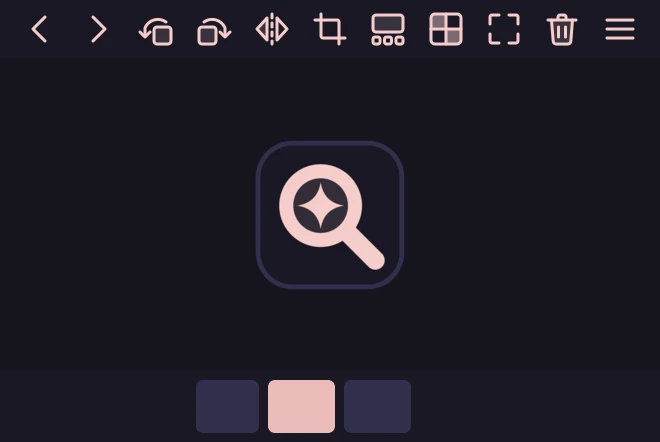<br/><b>Rosé Pine</b><br/><sub>Dusk violet and rose gold</sub></td>
</tr>
<tr>
<td align="center">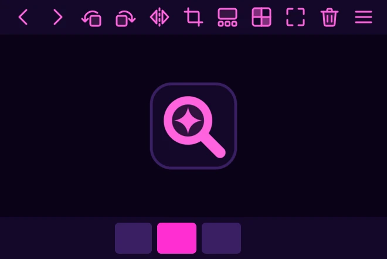<br/><b>Cyberpunk</b><br/><sub>Violet dark and hot neon</sub></td>
<td align="center">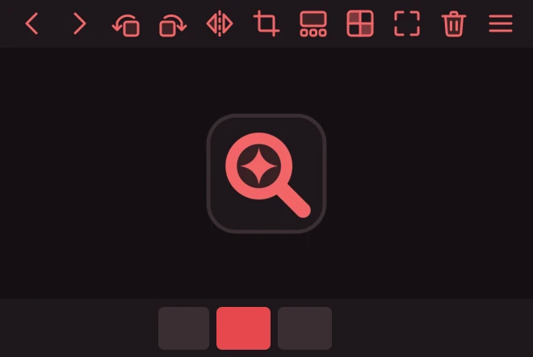<br/><b>Crimson</b><br/><sub>Warm greys and scarlet</sub></td>
<td align="center">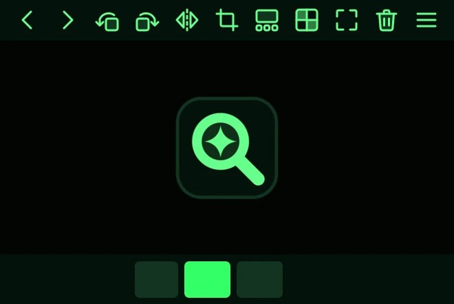<br/><b>Terminal</b><br/><sub>Green phosphor on black glass</sub></td>
</tr>
<tr>
<td align="center">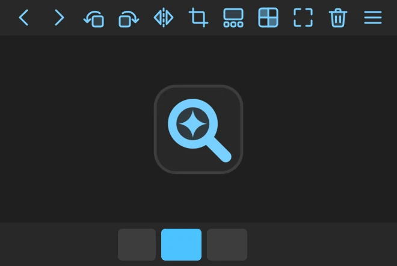<br/><b>Midnight</b><br/><sub>Neutral Windows dark</sub></td>
<td align="center">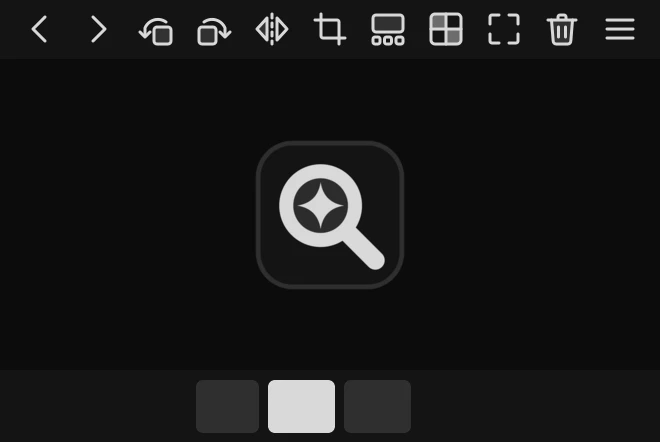<br/><b>Mono</b><br/><sub>Monochrome, only the photo has colour</sub></td>
<td align="center">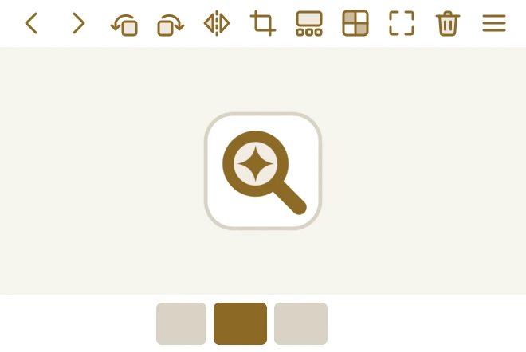<br/><b>Daybreak</b><br/><sub>Light: parchment and darkened gold</sub></td>
</tr>
<tr>
<td align="center">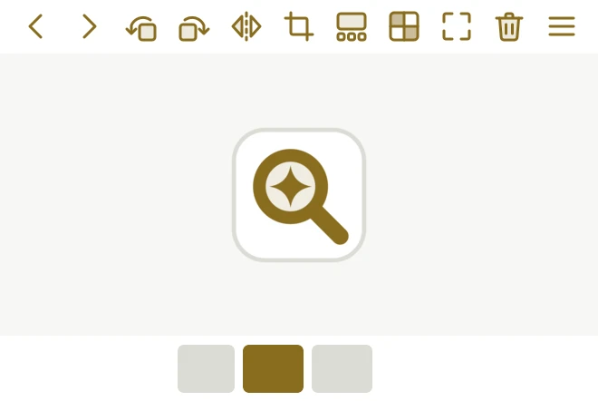<br/><b>Light</b><br/><sub>Light: paper white</sub></td>
<td></td>
<td></td>
</tr>
</table>

Dark mode uses the dark theme and light mode uses the light theme (Daybreak unless you choose otherwise).

### Add or change a theme

The 12 extra themes are generated from the FateGlass pack by
[`make-themes.ps1`](source/__assets/win/fateglass/make-themes.ps1). Each theme is one line of colours in that script:
surface, raised surface, overlay, border, text, accent and icon colour. Edit or add a line, then run:

```powershell
pwsh source/__assets/win/fateglass/make-themes.ps1
```

It rewrites `source/__assets/__app/_themes/<Name>/` with recoloured icons, logo, `igtheme.json` and a fresh
`preview.webp` (needs [ImageMagick 7](https://imagemagick.org)). To change the icons themselves, edit the SVGs in
`_themes/FateGlass/` and rerun the script so every theme picks them up.

---

## Lock zoom

Zoom into a photo, then press the padlock button (or **2**, or **Menu > Zoom > Lock zoom**). Moving to the next or
previous photo keeps the same zoom level and the same spot in the frame, which makes comparing a set of similar
shots easy. Press it again to release the lock and go back to the zoom mode you had before.

The padlock is not on the toolbar by default. Add it in **Settings > Toolbar** by dragging it from
**Available buttons** into **Current buttons**.

---

## Settings and defaults

FateGlass reads its settings in layers. Later layers win:

| Layer | Where | Purpose |
| --- | --- | --- |
| Defaults | `igconfig.default.json` next to `FateGlass.exe` | Ships with the installer. Holds the owner's settings. |
| Your settings | `%LocalAppData%\FateGlass\igconfig.json` | Everything you change. FateGlass saves the whole set when it closes. |
| Command line | `FateGlass.exe -p:ZoomMode=AutoZoom` | One-off overrides for a single launch |
| Admin policy | `igconfig.admin.json` next to `FateGlass.exe` | Locks settings and features; values here cannot be changed in the app |

On a fresh install, before you change anything, FateGlass looks exactly like the defaults file. Once your own
`igconfig.json` exists it overrides them, so a new installer never resets your setup.

### Every build ships the current settings

[`build-fateglass.ps1`](source/__assets/win/fateglass/build-fateglass.ps1) reads the live
`%LocalAppData%\FateGlass\igconfig.json` on the build machine and folds every changed preference into
`igconfig.default.json` before packaging. History is skipped (last image, last settings page, update bookkeeping).
The result is committed like any other change, so the next release carries it. Pass `-NoSettingsSync` to ship the
defaults file untouched; the release workflow always does, since the runner has no settings of its own.

### Portable mode

An empty file named `.igportable` next to `FateGlass.exe` moves every setting, cache and log into that folder. The
folder must be writable, so this suits a copy outside Program Files.

### Useful keys

| Key | Action |
| --- | --- |
| **← / →** | Previous or next photo |
| **2** | Lock zoom on or off |
| **0** | Actual size |
| **Ctrl + ,** | Settings |
| **F11** | Full screen |
| **F1** | About |

Every key can be changed in **Settings > Keyboard**, and mouse clicks in **Settings > Mouse**.

---

## Build from source

### What you need

| Tool | Version | For |
| --- | --- | --- |
| [.NET SDK](https://dotnet.microsoft.com/download/dotnet/10.0) | 10.0 | Building the app |
| [PowerShell](https://github.com/PowerShell/PowerShell) | 7.3 or newer | The build scripts |
| WiX Toolset | 5.0.2 | The MSI: `dotnet tool install --global wix --version 5.0.2` |
| Visual Studio "Desktop development with C++" | 2022 or newer | Optional: only for a Native AOT build (`-Aot`) |
| [ImageMagick](https://imagemagick.org) | 7.1 | Optional: only to regenerate themes or file type icons |

### Build the installer

```powershell
pwsh source/__assets/win/fateglass/build-fateglass.ps1
```

The MSI lands in `source/__artifacts/bundle/FateGlass_<version>_win-x64.msi`.

| Option | Effect |
| --- | --- |
| `-Aot` | Native AOT: one precompiled executable that starts faster. Needs the C++ workload. |
| `-Version 10.0.7` | Stamps a version on the app and installer instead of the one in `Directory.Build.props`. |
| `-NoSettingsSync` | Ships `igconfig.default.json` without folding in your live settings. |

Without `-Aot` the build is a regular self-contained .NET app: same features, slightly slower first start.

### Build for macOS

On an Apple silicon Mac with the .NET SDK 10.0 (`brew install --cask dotnet-sdk`) and the Xcode Command Line Tools
(`xcode-select --install`):

```bash
bash source/__assets/mac/fateglass/build-fateglass.sh            # builds ~/Library/Caches/FateGlass-build/FateGlass.app
bash source/__assets/mac/fateglass/build-fateglass.sh --install  # and copies it into /Applications
```

| Option | Effect |
| --- | --- |
| `--install` | Copies the app into `/Applications` and registers it with macOS. |
| `--dmg` | Also makes the download, `source/__artifacts/bundle/FateGlass_<version>_osx-arm64.dmg`. |
| `--version 10.0.7` | Stamps a version on the app instead of the one in `Directory.Build.props`. |

The app is put together outside the repository because iCloud Drive's Desktop & Documents sync tags any `.app` under
`~/Documents`, and `codesign` refuses a tagged app. Set `FATEGLASS_APP_DIR` to build it somewhere else.

It is always a Native AOT build, with the same themes, languages and `igconfig.default.json` as the Windows
installer, except that it turns on the toolbar and gallery in full screen. The Mac build does not fold in live
settings; that stays with `build-fateglass.ps1`. To sign for other
Macs, set `SIGN_IDENTITY="Developer ID Application: …"` before running it (notarizing is a separate step).

### Run from source

```powershell
cd source
dotnet build ImageGlass.Win32 -c Debug -p:Platform=x64
```

`-p:Platform=x64` is required. A debug build does not copy the themes and language files, so copy
`source/__assets/__app/*` next to the built `FateGlass.exe` once, and add an empty `.igportable` there so a test run
never touches your real settings.

### Regenerate artwork

```powershell
pwsh source/__assets/win/fateglass/make-themes.ps1      # all themes from the FateGlass pack
pwsh source/__assets/win/fateglass/make-ext-icons.ps1   # the 88 file type icons from the app mark
```

```bash
bash source/__assets/mac/fateglass/make-icon.sh          # FateGlass.icns, the macOS app icon (brew install librsvg)
```

The app icon is `source/ImageGlass.Win32/fateglass-icon.svg`; the two `icon256.ico` files are rendered from it. The
macOS icon comes from `source/__assets/mac/fateglass/fateglass-icon-mac.svg`, the same mark on Apple's icon grid.

---

## Make a release

The [Build installers](../../actions/workflows/release-installer.yml) workflow does the packaging.

1. Commit and push to `main`.
2. Create a release on GitHub with a tag such as `v10.0.7` and publish it.
3. The workflow builds both downloads side by side and attaches them to that release, usually within 15 minutes:
   `FateGlass_10.0.7_win-x64.msi` from a Windows runner and `FateGlass_10.0.7_osx-arm64.dmg` from an Apple silicon
   macOS runner, both Native AOT.

A tag that looks like a version (`v10.0.7` or `v10.0.7.1200`) becomes the app and installer version. Any other tag
keeps the version in `source/Directory.Build.props`. Installers upgrade each other in place, including two builds
with the same version.

To try a build without a release, open the workflow on the **Actions** tab and choose **Run workflow**. The MSI and
the disk image are kept as workflow artifacts for 90 days.

Before tagging, run a local build once so `igconfig.default.json` picks up your latest settings, and commit it.

---

## How it is built

FateGlass is ImageGlass 10: C# on .NET 10 with [Avalonia 12](https://avaloniaui.net) for the interface,
[SkiaSharp](https://github.com/mono/SkiaSharp) for rendering and [Magick.NET](https://github.com/dlemstra/Magick.NET)
for the less common formats. The changes live on top of the upstream code so upstream fixes can still be merged.

| Path | What it is |
| --- | --- |
| `source/ImageGlass.Lib` | The app: viewer, settings, themes, tools |
| `source/ImageGlass.Win32` | The Windows executable (`FateGlass.exe`) and app icon |
| `source/ImageGlass.Mac` | The macOS executable (`FateGlass`) |
| `source/__assets/__app` | Shipped payload: themes, languages, file type icons, transitions |
| `source/__assets/win/fateglass` | Installer (`FateGlass.wxs`), build and artwork scripts, default settings |
| `source/__assets/mac/fateglass` | `FateGlass.app`: `Info.plist`, app icon, build and icon scripts |
| `.github/workflows/release-installer.yml` | The release runner |

Where the personal changes are, for future upstream merges:

| Change | Code |
| --- | --- |
| Everything unlocked | `Core.IsProEnabled` in `ImageGlass.Lib/Core.cs` |
| Update check and its statistics removed | `UpdateProvider.CheckForUpdateAsync`, `FeatureManager.Refresh` |
| Upstream links blocked | `BHelper.OpenUrlAsync` in `Common/BHelper/Path.cs` |
| Name, settings folder, single-instance lock | `BHelper.AppName`, `Core.AppInstance`, `Lang.Get` (renames language packs at lookup) |
| Lock zoom toggle | `AppAPIProvider.IG_SetZoomMode` |
| Default themes | `Const.DEFAULT_THEME`, `Const.DEFAULT_LIGHT_THEME` |
| Mac executable name | `AssemblyName` in `ImageGlass.Mac/ImageGlass.Mac.csproj` (the bundle lives in `__assets/mac/fateglass`) |
| Default viewer on macOS | `MacShellProvider.SetDefaultPhotoViewerAsync`, `MacLaunchServicesApi`, the macOS rows in `FileTypeAssociationsSettingsView.axaml` |

### Keeping up with ImageGlass

```powershell
git remote add upstream https://github.com/d2phap/ImageGlass.git
git fetch upstream
git merge upstream/main
```

Most merges are clean. Conflicts, when they happen, are usually in the files listed above.

---

## Credits and license

FateGlass is based on [ImageGlass](https://github.com/d2phap/ImageGlass) by Dương Diệu Pháp and its contributors,
© 2010-2026, released under the GNU General Public License v3. FateGlass keeps that license: see [LICENSE](LICENSE).
If you find ImageGlass useful in your own work, its author sells Pro licenses that fund the project.

Format support comes from SkiaSharp, Magick.NET and libraries credited in the app's About window.

<br/>

<div align="center">
<sub>Provided by VagueDustin Enterprises™ · © 2026 FateGlass. Licensed under the GNU GPLv3.</sub>
</div>
